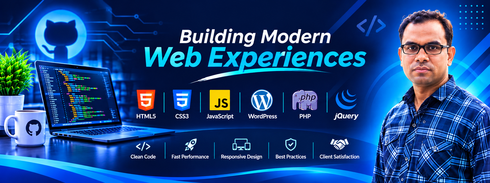

# 👋 Hi, I'm Md. Shah Alam

<!-- Upload your GitHub banner to assets/github-banner.png -->

  

<h2 align="center">Full Stack Web Developer | WordPress Specialist</h2>

  Building Modern, Responsive & User-Friendly Web Experiences

---

### 👨‍💻 About Me

Hello! I'm **Md. Shah Alam**, a Web Designer and Developer passionate about creating modern, responsive, and user-friendly websites.

I specialize in WordPress development, custom website design, front-end development, and website performance optimization.

I enjoy turning creative ideas into functional digital experiences that help businesses establish and grow their online presence.

- 💻 Specialized in WordPress and custom website development.
- 🎨 Passionate about modern UI/UX and responsive web design.
- ⚡ Focused on website speed and performance optimization.
- 🌱 Always learning new technologies and improving my skills.
- 🤝 Open to collaboration, freelance projects, and new opportunities.

### 🛠️ Technical Skills & Technologies

**Frontend Development**

  
  
  
  

**CMS & Backend**

  
  

**Other Skills**

- Responsive Web Design
- WordPress Theme Customization
- Website Redesign
- Performance Optimization
- Website Maintenance
- Git & GitHub

### 🚀 Featured Projects

Here are some website design and development projects:

| Project | Category |
|---|---|
| **Educeet – University Education** | Educational Website |
| **Edudash – Education Management Admin Dashboard** | Admin Dashboard |
| **Fashion Boutique eCommerce** | E-commerce Website |
| **Greva – Ecology & Environment** | Environmental Website |
| **Luxine – Architecture & Interior** | Business Website |
| **Orgaanic – Agriculture & Organic Farm** | Agriculture Website |
| **Renovex – Construction Business** | Corporate Website |
| **Rivora – Hotel Booking & Travel** | Travel & Hospitality |

### 📊 GitHub Statistics

  

  

  

### 📫 Let's Connect

I'm always interested in connecting with developers, businesses, and people who have exciting ideas.

- **GitHub:** [github.com/msap48](https://github.com/msap48)
- **Email:** [msap48@gmail.com](mailto:msap48@gmail.com)

---

  <b>Building Modern Web Experiences</b>
   
  Turning Ideas into Powerful Digital Solutions.

  ⭐ Thanks for visiting my GitHub profile!

